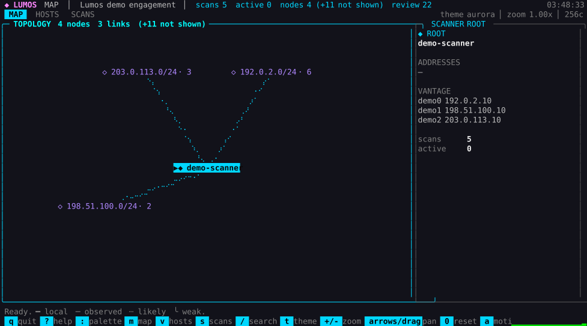
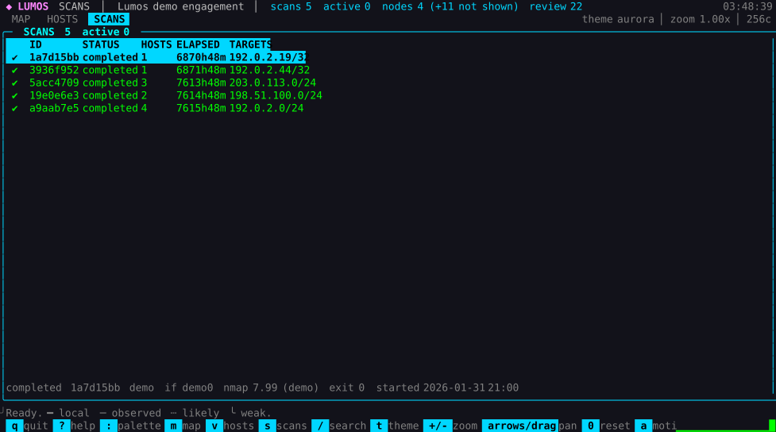

# Lumos Network Mapper

[](https://github.com/lko47/lumos/actions/workflows/tests.yml)



Lumos is a terminal-first network mapper built on the user's own installed Nmap. It stores scan observations, scope, audit history, review flags, and notes in a portable SQLite engagement file. Use it only for systems and networks you own or are explicitly authorized to assess. Lumos is not affiliated with the Nmap Project and does not bundle Nmap.

The project name is provisional. No game assets, names, or layouts are used.

## Requirements and safety

- Python 3.10 or newer; runtime code uses only the standard library.
- Nmap installed separately and available on `PATH` (or supplied with `--nmap`). Lumos never downloads Nmap or reads its data files.
- Linux is the initial platform target. No Windows support is planned for version 1.
- The CLI runs as the invoking user. Nmap may need capabilities or elevated privileges for selected scan modes; never run the whole UI as root.
- Scan only authorized targets. Lumos checks targets against engagement-wide allow and exclude rules before starting Nmap. An out-of-scope override requires the exact displayed phrase and is recorded.
- Nmap XML and imported databases are untrusted input. Protect engagement files with OS permissions, access controls, and disk encryption. Do not store credentials in notes or scan scripts.

## Current status

Version 0.2.0. The planned feature set is implemented; the remaining gaps are
release work (a public screenshot, a scale benchmark, a second review of the
newer parsers), not missing features. Everything below is exercised by the test
suite unless it says otherwise.

| Area | State | How it is known |
| --- | --- | --- |
| Database, schema, migrations | done | schema tests, `lumos db check`, forward-only upgrade tests |
| Scope guard | done | every scan path is scope-checked; out-of-scope targets are refused with a typed phrase |
| Nmap scanning | done, real binary | run against the installed Nmap, XML streamed and stored as compressed evidence |
| masscan, naabu, rustscan | **parsers only** | output recorded as fixtures and replayed through a fake binary; **never run against the real tools here** |
| Import of external Nmap XML | done | hostile-input tests: doctype rejected, depth/bytes bounded, truncation reported |
| Map and TUI | done | PTY-driven tests for keys, mouse and dialogs; three themes plus `NO_COLOR` |
| Notes, tags, pins, review queue | done | service tests plus PTY dialogs |
| Manual nodes and links | done | survive inference rebuilds; CLI and `u` in the interface |
| Duplicate proposals | done | merge/reject recorded as events; identity is never merged automatically |
| Compare, queue, target files | done | per-feature tests; a queue is an intention, not a measurement |
| Exports | done | markdown, svg, json, csv, html, dot, mermaid, stored nmap-xml |
| Pseudonymised export | done | schema-wide rewrite plus a byte-level proof pass |
| Plugins | done | exporters and themes, versioned, per-file isolation |
| Profiles | done | JSON profiles; a profile cannot redefine a built-in or smuggle a refused flag |
| Packaging | done | `pipx install .`, zipapp, man page, Apache-2.0 licence |
| Interactive latency | measured as a pure function only | see `docs/BENCHMARKS.md`; frame latency in a real terminal is not measured |
| Scale | not measured | nothing above an 11-host demo has been benchmarked |

**Not implemented by design:** `-oX`/`-oA`/`-iL`/`--script` (refused — they write a
second artefact or read targets behind the scope guard), setuid or polkit
elevation, Windows support, and an NSE script browser. **Not implemented yet:**
line-by-line Nmap stderr in the interface, scheduled scans, and pcap replay.

The interface: mouse-first and keyboard-first. Three slow dots travel outward
along every link, coloured by how well the path is known — green measured
(traceroute or a directly observed host), amber inferred, red weak inference or an
unknown hop, cyan local interface. Manual and imported links never move, because
motion is a claim about direction. New nodes blink in with a short ripple, and a
liveness strip advances once a second from real event counters, never a random
number (`a` turns motion off, which is also what a screen reader or `script(1)`
capture wants). Tab switching, map nodes, table rows, footer hints and dialog
fields are clickable; the wheel zooms at the pointer and scrolls lists; dragging
pans. `0` recentres and every mouse action has a keyboard equivalent.

The map draws only stored `topology_edges`, using a tested braille rasterizer with
per-edge-type patterns and an ASCII fallback (`LUMOS_ASCII=1` forces it). Node
placement is a deterministic ring keyed on a blake2b hash of the node id, so new
discoveries never reshuffle existing nodes. The detail sidebar lists addresses, OS,
open ports, hop distance, review flags and, for the scanner root, the interfaces
saved by `lumos interfaces --save`. Edge selection shows provenance, confidence and
timestamps.

Colour is semantic rather than hard-coded: themes `aurora`, `ember` and `matrix`
degrade to 16-colour palettes, and `NO_COLOR` selects a monochrome theme that keeps
hierarchy through weight and reverse video. `LUMOS_THEME` picks the starting theme;
plugins can add palettes but cannot replace a built-in one.

The interface watches committed snapshots, so a concurrent scan appears after its
SQLite commit. Scan progress streams from Nmap's `<taskprogress>` element when the
installed build supports `--stats-every` (7.60+); older builds show elapsed time
and a working indicator. `Esc` twice cancels a running scan, keeping the hosts
already written. Traceroute-driven topology is not inferred from the default
connect scan, because Nmap documents that `-sT` cannot produce it.

Every surface — creating a database (`N`), scope (`P`), XML import (`I`), reports
(`R`), database tools (`T`) and the event log (`!`) — is reachable from the map, from
the `:` palette, and from the CLI. Both front ends call the same functions in
`services/actions.py`.
### Keys worth knowing

| Key | Action |
| --- | --- |
| `m` `v` `s` / `Tab` | map, hosts, scans |
| click / `Enter` | select a node, edge, row or field |
| `o` / `O` | toggle the selected hub / collapse every hub |
| `[ set start ]` `[ set end ]` | click the sidebar buttons to mark a path |
| `b` / `y` / `f` | note / tags / pin the selected node |
| `z` | review queue: pick an item, then confirm, ignore, flag or mark out of scope |
| `a` | motion on/off (dots, ripples, solid links) |
| `+` `-` `0` | zoom in, zoom out, recentre |
| arrows, `HJKL`, drag, wheel | pan, and zoom at the pointer |
| `S` | scan form (preset, engine, targets, network) |
| `w` | add another engagement to the view |
| `,` | enumeration settings (engine checkboxes) |
| `N` `P` `I` `R` `T` `!` | new engagement, scope, import XML, report, database tools, event log |
| `?` `:` `/` | help, command palette, search |
| `lumos note DB "text" --node ID` | attach a note to a node (`--list` to read them back; the sidebar shows the newest) |
| `lumos tag DB dmz --node ID` | tag a node (`--list`, `--remove`) |
| `lumos export DB OUT` | pseudonymised copy for sharing (`--force` to replace) |
| `lumos queue DB --add --network N TARGET` | queue scans (`--list`, `--remove ID`, `--clear`, `--run`) |
| `lumos review DB [--decide ID --set confirmed]` | review queue and decisions |
| `lumos scan DB --target-file FILE` | scope-checked targets from a file (`-sn` preset for discovery) |
| `lumos report json\|csv\|html DB OUT` | machine-readable exports (owner-only files) |
| `lumos compare DB` | diff the last two completed scans (`--from`/`--to` take an id or a unique prefix, `--list` shows them) |

### Engagements, hubs and paths

Several engagement files can be opened in one view (`w`): each file keeps its own cluster, node ids are prefixed per member, roots are labelled `[engagement] host`, and any host whose address appears in more than one file is joined to its twin by a `═` bridge in the `shared` evidence class. Files are opened `mode=ro` and are never rewritten, so the imported engagement stays exactly as it was; the caps are eight members and 128 bridges.

Hubs are **collapsed by default**, so the map opens as a view of hops rather than a wall of hosts. The SELECTED panel carries `[ expand members ]` / `[ collapse members ]` for the chosen hub (`o` toggles the selected hub, `O` collapses every hub), which is also how a NAT'd inner network folds into the single straight link between its parent and the hub.

`[ set start ]` and `[ set end ]` mark two nodes and highlight the shortest path between them: path nodes carry a `▶` marker, the links on the path take the path style, and the hop count appears in the panel and the status line. The path is a breadth-first search over the edges the current view actually draws, so collapsing a hub really does change the route, and an unreachable pair reports that instead of drawing a line.

## Quick start

```sh
pipx install .        # or: python3 -m pip install --user .
lumos                 # opens the interface; N creates the first engagement
lumos engagement.sqlite
```

Everything below is also reachable from the interface; the CLI remains for
scripting and for headless machines. From a source checkout, prefix each with
`PYTHONPATH=src python3 -m`:

```sh
lumos interfaces --json
lumos db init ./engagement.sqlite --name "Example assessment"
lumos interfaces ./engagement.sqlite --save
lumos scope add ./engagement.sqlite 192.0.2.0/24 --network example --author analyst
lumos scope show ./engagement.sqlite
lumos scan ./engagement.sqlite 192.0.2.10 --network example
lumos import ./engagement.sqlite ./saved-scan.xml --network example
lumos report markdown ./engagement.sqlite ./assessment.md
lumos db merge ./engagement.sqlite ./copy.sqlite --dry-run
lumos db check ./engagement.sqlite
```

Interface keys: `N` new engagement, `P` scope rules, `S` scan, `I` import XML,
`R` report, `T` tools (check, upgrade, rebuild, merge, interfaces), `!` event
log, `:` palette, `?` help. Existing map keys (`m`/`v`/`s`, `o`/`O`, `i`,
`p`/`x`, `/`, `t`, `+`/`-`, `H J K L`, `0`, `q`) are unchanged.

`192.0.2.0/24` is documentation-only address space; replace it with an explicitly authorized target and scope. By default, the scan command displays its exact command and asks for interactive confirmation. In non-interactive use, `--yes` skips that prompt; review the target and options before using it in automation. For a target outside the allowlist the scan is blocked: the TUI asks you to tick an acknowledgement and press a red Confirm button, and the CLI prints the exact override phrase to pass with `--confirm-scope`. Both are recorded in the audit log.

To run the offline test suite without network access or a real scan:

```sh
PYTHONPATH=src python3 -m unittest discover -s tests -v
```

Every fixture and test uses reserved address space, never a real network: RFC 5737
documentation ranges (`192.0.2.0/24`, `198.51.100.0/24`, `203.0.113.0/24`), RFC 3849
`2001:db8::/32`, RFC 2544 benchmarking space (`198.18.0.0/15`) for the synthetic
scale benchmark, and locally administered MACs (`02:00:…`). `10.0.0.0/24` appears in
prose only, as the textbook example of two private networks that share a CIDR. No
engagement database, scan XML, or report is committed.

Database creation refuses to overwrite an existing path and sets owner-only permissions. Report output is also created owner-only. Do not commit engagement databases, raw scan XML, or generated reports: `.gitignore` excludes them, and `tests/test_repo_hygiene.py` fails the suite (and CI) if one is ever tracked. Committed Nmap XML is limited to synthetic fixtures under `tests/fixtures/nmap/`. `lumos db upgrade DATABASE` applies forward-only migrations to an existing file in place; the database keeps `application_id` `0x4C554D53` ("LUMS") and `user_version` 3.

## Data handling and Nmap

Lumos invokes the Nmap executable selected from `PATH` with an argument list and no shell. It parses Nmap XML incrementally, keeps completed hosts when possible after truncated output, and caps imported XML size and nesting. Imported Nmap XML is retained in compressed form by default; pass `--no-evidence` to disable evidence retention for scans or imports. Nmap-supplied text is sanitized before terminal/report output.

The database records scan commands, Nmap version, timestamps, operator, interface, vantage point, scope override status, and exit state. A scan whose process died without finishing (crash, killed terminal) is closed as `failed` and logged as `scan_interrupted` the next time the engagement is opened or scanned, so the interface stops reporting a scan that no longer exists. Scope rules are engagement-wide; `--network` associates observations with a named network and does not narrow the scope rules. Exact-hostname allow rules are required before hostname preflight resolution.

## Merge identity and schema

The file format is designed for a read-only merge that does not duplicate rows:

- Row ids for networks, addresses, devices, vantage points, topology nodes and edges, tags, scope rules, and review items are UUIDv5 values derived from each row's natural key (`core/ids.py`). Re-importing the same scan or merging the same source twice therefore resolves to the same ids.
- The engagement itself is identified by `meta.engagement_uid`, derived once from the engagement name and creation timestamp. A merge is only accepted when the source uid matches; every incoming `engagement_id` is then rewritten to the local `engagement.id` while child ids stay unchanged. A different uid is a different engagement and is rejected, never silently rehomed.
- Devices are deliberately **not** keyed on address or hostname: the same host seen twice stays two devices with a duplicate proposal until a human decides.
- Schema 2 adds `meta` and `merge_log` (one row per merge attempt, with outcome `applied`, `rejected`, or `dry_run`), plus unique indexes on the natural keys of scope rules, review items, duplicate proposals, topology edges, vantage points, trace paths, script observations, and identity claims. Exact duplicates are collapsed to the earliest row when a v1 file is upgraded.
- `lumos db merge TARGET SOURCE` copies another copy of the same engagement into the target. A source with a different `engagement_uid` is refused and recorded in `merge_log` with outcome `rejected`; a matching one is copied table by table with `INSERT OR IGNORE`, so re-running the merge adds nothing. `--dry-run` does the inserts inside a savepoint, reports what would be new, then rolls them back and logs `dry_run`. After a merge the inference engine re-runs, so rejected links stay rejected and promoted ones stay manual.
- `lumos db upgrade DATABASE` migrates an existing v1 file in place; `lumos db check DATABASE` verifies `application_id`, `user_version`, the table/view set, foreign keys, and integrity.

## Inferred links

Not every scan has traceroute data: unprivileged scans fall back to `connect()`
probes, which skip ARP, and Nmap's traceroute does not work with connect
scans. Lumos therefore derives a *likely* structure from facts it does store,
and marks every derived row so a guess never looks like a measurement.

Inputs are recorded per scan: the interface table (address, prefix, type) and
the routing table from `nmap --iflist`, captured automatically when a scan
starts, plus each host's status reason, reason TTL and MAC. `lumos db rebuild
DATABASE` re-derives everything from those facts; it also runs automatically
after a completed scan or import.

| Rule | Draws | Confidence |
| --- | --- | --- |
| `local_interface` | scanner root to a segment hub for one of its own connected networks | 1.0 |
| `on_link_arp` | hub to host, when the host answered ARP/ND and has a MAC | 0.95 |
| `on_link_address` | hub to host, addressing only | 0.70 |
| `gateway_on_link` | hub to the gateway (the scanned device, else a placeholder hop) | 0.90 |
| `routed_via_gateway` | gateway to a routed-subnet hub, then hub to host | 0.50 / 0.60 or 0.40 (assumed prefix) |
| `unknown_path` | root to a "path unknown" hub, then hub to host, when no interface or route data exists | 0.20 / 0.40 |

Hubs are broadcast domains or routed subnets, never devices, and are keyed on
the network row plus the CIDR, so two scanners in one network share a hub and
two different `10.0.0.0/24` networks never merge. An observed traceroute path
from the same vantage point always wins: that host gets no inferred link, but
keeps its zone membership. Many addresses answering ARP with one MAC are
treated as suspected proxy ARP: those links are downgraded to addressing
evidence and one review item names the MAC. Tunnel interfaces never supply ARP
evidence, and link-local IPv6 or host routes (`/32`, `/128`) never create a
segment hub. Virtual bridges (`docker0`, `br-`, `virbr`, `veth*`) are marked
`virtual` and hidden until a scan puts members on them. A host's status TTL is
shown in the details panel as an "about N hops" hint (never drawn), and rings
are labelled *depth*, not hops.

Every derived edge stores its rule, rule version and the row ids it used in
`evidence_json`; `edge_decisions` records a user's `promoted` or `rejected`
choice and survives rebuilds and merges. Rows the rebuild does not regenerate
are deleted, but only when `derived = 1`.

Rendering uses the evidence class: solid for observed and local links, dense
dots for likely (>= 0.6), sparse dots for weak evidence, and a dashed style for
manual links. Hubs draw as one node with their member count (`◇ 10.0.0.0/24 ·
212`), assumed hubs keep the `~`, gateway placeholders draw hollow, and the
status bar carries a one-line legend that degrades to ASCII.

A hub with more than 50 members collapses: its member nodes and links are not
selected at all, so a 100,000-host engagement of 400 `/24` networks opens as 401
nodes and draws a frame in ~28 ms (benchmark below).

Selecting a link explains it: the sidebar shows the rule, and a plain sentence
such as "Inferred by on_link_arp: 198.51.100.14 is inside 198.51.100.0/24 on eth0
and answered ARP. Confidence 0.95." On an inferred link `p` promotes it to a
manual link (recorded with the author) and `x` rejects it, each after a second
press; both choices go to `edge_decisions` and survive rebuilds. `i` hides or
shows inferred links.

A collapsed hub expands on request: select it and press `o` (`O` collapses all).
Expansion re-runs the same bounded query with that one hub's members included,
and `load_hub_members()` pages a hub's member list (label, addresses, node id)
without materialising the network, so a /16 with 60,000 hosts stays openable.

Reports tell the same truth as the map. `lumos report markdown` lists inferred
links in their own table with rule and confidence and states that they were not
measured; `lumos report svg DATABASE OUT.svg` draws them dotted (three-on/two-off
for likely, one-on/five-off for weak) while measured and local links stay solid,
labels hubs with their CIDR and member count, and repeats the caveat in the
image and its description.

## Screens



Both images are generated, not captured by hand: `scripts/make_screenshot.py`
writes a demo engagement with `lumos demo`, drives the interface in a
pseudo-terminal and converts the character grid to SVG. That means the network in
the pictures cannot be somebody's real network, and the images can be regenerated
after a layout change instead of drifting from the code. The generator needs
`pyte` (`pip install pyte`); nothing in the runtime does.

## What the scanner cannot see

Two kinds of human knowledge are stored as claims, not observations, and neither is ever overwritten by a scan:

- **Manual nodes and links** — `lumos manual DB --add "console-only switch" --note "no management IP"`, then `--link FROM TO`. In the interface, `u` adds a node. Manual nodes survive every inference rebuild; manual links are drawn bold (DOT/Mermaid) because a human asserted them.
- **Duplicate proposals** — when two observations share an address or hostname, Lumos records a proposal and merges nothing. `lumos duplicates DB` lists them; `--accept ID` merges the two devices into one (re-pointing every observation, keeping both), `--reject ID` keeps them apart. In the interface, `d`. A merge rebuilds the derived topology afterwards.

## Scan profiles

`~/.config/lumos/profiles.json` (or `LUMOS_PROFILES`) adds named profiles on top of the built-ins:

```json
{"profiles": {"quick-web": {"options": "-sT -p 80,443", "description": "just the web ports"}}}
```

They appear in the scan form's preset list. A profile cannot redefine a built-in name, and options using `-oX`, `-oA`, `-oN`, `-oG`, `-iL`, `-iR`, `--script` or `--script-args` are refused — those either write a second artefact or read targets behind the scope guard.

## Plugins

Two kinds, both optional and both versioned: **exporter** plugins add a report format (`lumos report plugin DB OUT --name NAME`) and **theme** plugins add a palette (they join the `t` cycle). They load only from `LUMOS_PLUGIN_PATH` and `~/.config/lumos/plugins`; `lumos plugins` lists what would load and every refusal; `--no-plugins` or `LUMOS_NO_PLUGINS=1` turns the whole surface off.

A plugin is arbitrary Python with your privileges — the loader validates declarations and refuses API mismatches, but consent is the actual defence. See `docs/PLUGINS.md`, with working examples in `examples/plugins/`. `docs/ZENMAP-PARITY.md` records what Zenmap does that Lumos does not.

## Exports other tools can read

| Command | Output |
| --- | --- |
| `lumos report markdown DB OUT.md` | the engagement as prose, inferred links labelled with their rule |
| `lumos report svg DB OUT.svg` | the map, dotted where evidence is inferred |
| `lumos report json DB OUT.json` | hosts, ports, links, notes and tags as data (no timestamp, so it diffs) |
| `lumos report csv DB OUT.csv` | one row per port |
| `lumos report html DB OUT.html` | a self-contained page |
| `lumos report dot DB OUT.dot` | Graphviz: solid = measured, dashed = inferred, bold = manual |
| `lumos report mermaid DB OUT.mmd` | a `flowchart` that renders in Markdown without plugins |
| `lumos report nmap-xml DB OUT.xml [--scan ID]` | the stored Nmap XML for one scan, re-emitted verbatim |

Only `nmap-xml` is evidence rather than a rendering of it, so it refuses to invent anything: with no `--scan` it takes the newest stored scan, and it errors when the scan kept no evidence instead of writing an empty document.

## Sharing an engagement safely

`lumos export DB OUT` writes a **pseudonymised copy**: every address becomes a documentation-range address, every hostname a `host-<hash>.example`, every MAC a locally-administered `02:00:...` one, and stored Nmap evidence is rewritten too so the raw XML cannot leak what the tables no longer hold.

The mapping is deterministic per engagement (derived from the engagement id), so two exports agree and a host keeps its pseudonym between the database and a report, but nothing in the export recovers the original. The source database is never opened for writing — the export is a copy, and its bytes are checked before returning: if any original value survives in any text column or evidence blob, the export fails instead of shipping.

## Queueing scans

`lumos queue` records scans to run later, in the order given, and `--run` executes them one at a time through the same scope-checked path as a typed scan.

A queued job is an intention, not a measurement, so it lives in `<database>.queue.json` beside the database (owner-only, written through a temporary file) rather than in a table: no schema change, and a queue that never ran leaves no trace in the evidence. The file is treated as hostile on load - every field re-validated and sanitised, an unknown engine falls back to `nmap`, 32 jobs and 512 targets per job, and a file that cannot be understood is an error sentence rather than a silently empty queue.

A failure stops the run and keeps the rest of the queue: the next job may have been queued *because* of what the failed one would have found.

## History hygiene

`tests/test_repo_hygiene.py` fails the suite on personal data in the files on disk; `python3 scripts/check_history_pii.py` walks **every revision, every commit message and every author identity**, because a file sanitised today can still be reachable through an earlier commit. It is run by the test suite and belongs in a pre-release pass.

The history has been rewritten once for this reason (`git filter-repo`, force-push, tag re-pointed): real subnets became documentation ranges, `/home/<user>` paths became `/home/user`, a host label became `scanner-host`, and the author identity became a GitHub noreply address. Old commits that GitHub still holds are no longer referenced by any branch or tag.

## Development status and project hygiene

CI and unit tests do not run scans and require no network access: they replay recorded
fixtures through a fake Nmap executable. The Nmap path itself has been exercised
against a real Nmap 7.993 binary on this machine and on `127.0.0.1`; **masscan,
naabu and rustscan have only ever been exercised through their parsers and fake
binaries, never against the real tools**, and that is the most important
unverified surface in the project. Python 3.10 is now covered: CI runs the suite
on 3.10 and 3.14, and both are green.

`bench/map_benchmark.py` builds synthetic 10k/100k-host engagements and reports load and frame timings; it is a development tool and needs no network or Nmap access. Results on this machine (Python 3.14.9, 8 CPUs) are recorded in the project plan rather than in CI.

Coding standard: a mechanical subset of the JSF-AV C++ rules — function length,
parameter count, line length, declarations — is enforced by
`python3 scripts/check_standards.py` with a shrink-only baseline, and every
deviation is recorded in [`docs/standards/JSF-AV-ALIGNMENT.md`](docs/standards/JSF-AV-ALIGNMENT.md).
This is a style floor borrowed from an avionics C++ standard, not a claim of
JSF-AV conformance: automated code is not flight software.

Architecture diagrams — context, layers, scan and merge sequences, threads, the
schema split into four ER diagrams, the inference rules and the module import
graph — live in [`docs/architecture/README.md`](docs/architecture/README.md).

What this tool is checked against, what the checks actually enforce, and which
claims are *not* verified: [`docs/SECURITY-COMPLIANCE.md`](docs/SECURITY-COMPLIANCE.md)
(JSF-AV ratchet, an OWASP Top 10 reading, the MITRE ATT&CK techniques the output
documents, privacy guards). Those mappings are an argument about how the tool is
built, not a certification.
The ER and module diagrams are generated by `scripts/gen_erd.py` and
`scripts/gen_modules.py`; `tests/test_architecture.py` fails when a committed
copy is stale or when `core` imports `tui`, `cli` or `plugins`.

## License

Apache License 2.0 — see `LICENSE`. You may use, modify and redistribute this
code, including commercially, provided you keep the licence and `NOTICE` with any
redistribution and state what you changed. The licence includes an explicit
patent grant and a trademark clause: it grants no rights to the name "Lumos".

`NOTICE` records the one attribution this project does owe: Lumos runs the user's
own Nmap, is not affiliated with the Nmap Project, and does not bundle or download
Nmap. Nmap is a separate program under its own licence and trademarks.

Security reports go through a private advisory; see `SECURITY.md`.
