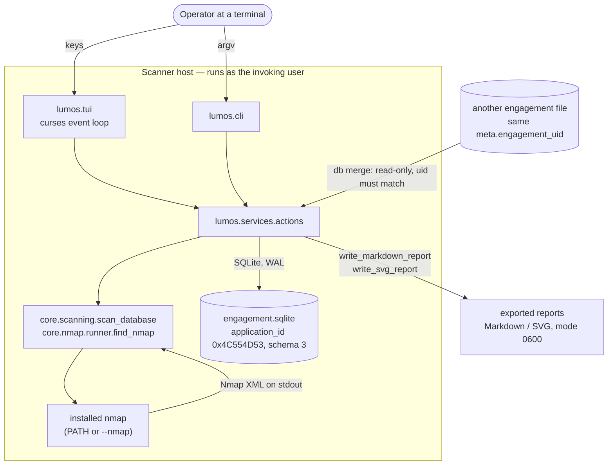

# Context

Shows the operator, the scanner host with the curses interface and CLI, the host's own Nmap binary, the engagement SQLite file, another engagement file used only as a merge source, and exported reports.
Leaves out every process, thread, table and HTTP-shaped integration inside the scanner host; there is no server, no telemetry and no bundled copy of Nmap.
Derived from `README.md`, `src/lumos/cli.py`, `src/lumos/services/actions.py` and `core/nmap/runner.py::find_nmap`.

