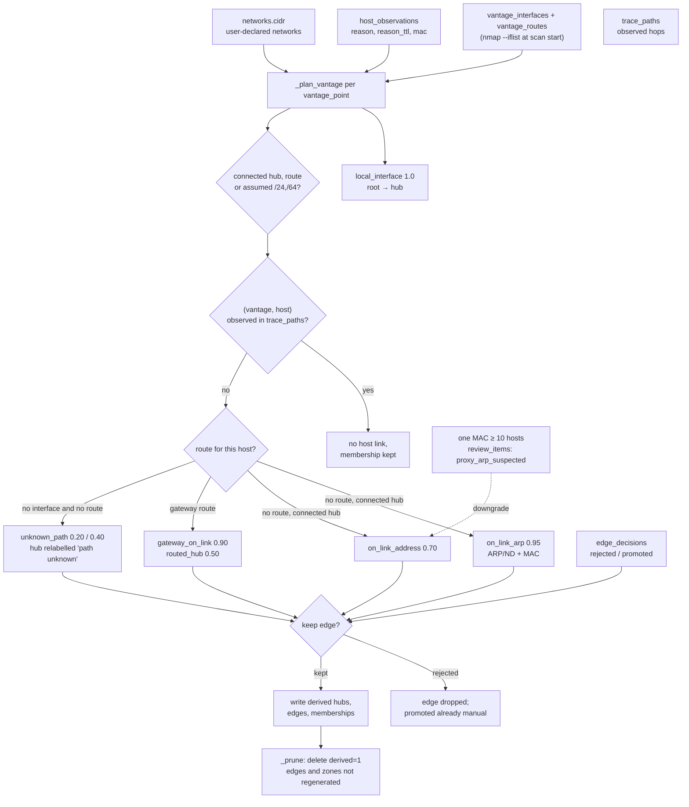

# Inferred links

Shows what `rebuild_inferred` reads, the order the six rules run in, where an observed traceroute suppresses an inferred link, how `edge_decisions` and proxy-ARP change the result, and what the rebuild deletes.
Leaves out the per-address evidence JSON, the UUIDv5 id derivation in `core/ids.py`, and the foreign-hub exemption for `/32`, `/128` and link-local addresses.
Derived from `core/inference.py::_rebuild`, `_plan_vantage`, `_review_mac`, `_prune`, `_prune_hubs` and `core/evidence.py`.

