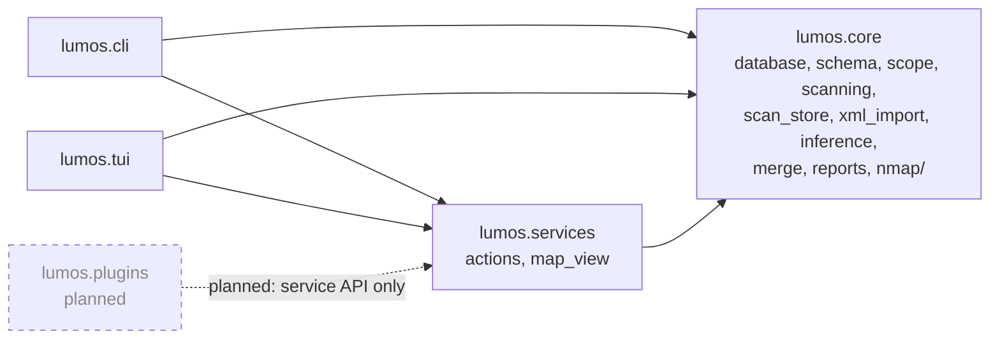

# Layers

Shows the four shipped packages (`lumos.core`, `lumos.services`, `lumos.cli`, `lumos.tui`), the plugin package that is planned but absent, and the import direction the code actually uses.
Leaves out intra-package module edges (see `modules.md`), which function each arrow carries, and the Nmap subprocess boundary (`core.nmap.runner`), which is inside `lumos.core`.
Derived from the `ast` import graph of `src/lumos/**` (see `scripts/gen_modules.py`) and enforced by `tests/test_architecture.py`.

`lumos.core` imports none of `lumos.tui`, `lumos.cli`, `lumos.services` or
`lumos.plugins`; that is the direction the test pins. `lumos.core.nmap` and
`lumos.core` import each other (the runner needs `scope`/`text`, the stores need
`runner` records); they are drawn as one layer here and as two packages in
`modules.md`.
