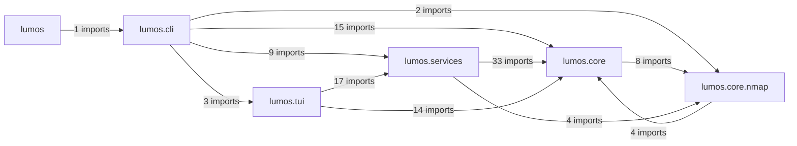

# Module imports

Shows which packages import which, aggregated from the `ast` import graph of every file under `src/lumos`.
Leaves out individual module edges, the direction of each call, and any import that stays inside one package; the table below lists every cross-package module edge.
Generated by `scripts/gen_modules.py`; do not edit by hand.

| importing module | imported module |
| --- | --- |
| `lumos.__main__` | `lumos.cli` |
| `lumos.cli` | `lumos.core` |
| `lumos.cli` | `lumos.core.database` |
| `lumos.cli` | `lumos.core.engine_scan` |
| `lumos.cli` | `lumos.core.inference` |
| `lumos.cli` | `lumos.core.merge` |
| `lumos.cli` | `lumos.core.nmap.iflist` |
| `lumos.cli` | `lumos.core.nmap.runner` |
| `lumos.cli` | `lumos.core.reports` |
| `lumos.cli` | `lumos.core.scan_store` |
| `lumos.cli` | `lumos.core.scanning` |
| `lumos.cli` | `lumos.core.scope` |
| `lumos.cli` | `lumos.core.scope_store` |
| `lumos.cli` | `lumos.core.state` |
| `lumos.cli` | `lumos.core.vantage_store` |
| `lumos.cli` | `lumos.core.xml_import` |
| `lumos.cli` | `lumos.services` |
| `lumos.cli` | `lumos.services.actions` |
| `lumos.cli` | `lumos.services.compare` |
| `lumos.cli` | `lumos.services.demo` |
| `lumos.cli` | `lumos.services.notes` |
| `lumos.cli` | `lumos.services.queue` |
| `lumos.cli` | `lumos.services.review` |
| `lumos.cli` | `lumos.services.sanitize` |
| `lumos.cli` | `lumos.services.tags` |
| `lumos.cli` | `lumos.tui.app` |
| `lumos.cli` | `lumos.tui.start` |
| `lumos.core.nmap.iflist` | `lumos.core.text` |
| `lumos.core.nmap.runner` | `lumos.core.scope` |
| `lumos.core.nmap.runner` | `lumos.core.text` |
| `lumos.core.nmap.xml_stream` | `lumos.core.text` |
| `lumos.core.reports` | `lumos.core.nmap.xml_stream` |
| `lumos.core.scan_store` | `lumos.core.nmap.runner` |
| `lumos.core.scan_store` | `lumos.core.nmap.xml_stream` |
| `lumos.core.scanning` | `lumos.core.nmap.iflist` |
| `lumos.core.scanning` | `lumos.core.nmap.runner` |
| `lumos.core.vantage_store` | `lumos.core.nmap.iflist` |
| `lumos.core.xml_import` | `lumos.core.nmap.runner` |
| `lumos.core.xml_import` | `lumos.core.nmap.xml_stream` |
| `lumos.services.actions` | `lumos.core` |
| `lumos.services.actions` | `lumos.core.database` |
| `lumos.services.actions` | `lumos.core.inference` |
| `lumos.services.actions` | `lumos.core.merge` |
| `lumos.services.actions` | `lumos.core.nmap.iflist` |
| `lumos.services.actions` | `lumos.core.nmap.runner` |
| `lumos.services.actions` | `lumos.core.reports` |
| `lumos.services.actions` | `lumos.core.scan_store` |
| `lumos.services.actions` | `lumos.core.scanning` |
| `lumos.services.actions` | `lumos.core.scope` |
| `lumos.services.actions` | `lumos.core.scope_store` |
| `lumos.services.actions` | `lumos.core.state` |
| `lumos.services.actions` | `lumos.core.text` |
| `lumos.services.actions` | `lumos.core.vantage_store` |
| `lumos.services.actions` | `lumos.core.xml_import` |
| `lumos.services.compare` | `lumos.core.database` |
| `lumos.services.demo` | `lumos.core.database` |
| `lumos.services.demo` | `lumos.core.inference` |
| `lumos.services.demo` | `lumos.core.nmap.iflist` |
| `lumos.services.demo` | `lumos.core.nmap.xml_stream` |
| `lumos.services.demo` | `lumos.core.scan_store` |
| `lumos.services.demo` | `lumos.core.vantage_store` |
| `lumos.services.map_view` | `lumos.core.database` |
| `lumos.services.map_view` | `lumos.core.evidence` |
| `lumos.services.map_view` | `lumos.core.text` |
| `lumos.services.notes` | `lumos.core.database` |
| `lumos.services.notes` | `lumos.core.text` |
| `lumos.services.positions` | `lumos.core.database` |
| `lumos.services.positions` | `lumos.core.text` |
| `lumos.services.queue` | `lumos.core.scope` |
| `lumos.services.queue` | `lumos.core.text` |
| `lumos.services.review` | `lumos.core.database` |
| `lumos.services.review` | `lumos.core.text` |
| `lumos.services.sanitize` | `lumos.core.database` |
| `lumos.services.sanitize` | `lumos.core.merge` |
| `lumos.services.tags` | `lumos.core.database` |
| `lumos.services.tags` | `lumos.core.text` |
| `lumos.tui.app` | `lumos.core` |
| `lumos.tui.app` | `lumos.core.decisions` |
| `lumos.tui.app` | `lumos.core.engines` |
| `lumos.tui.app` | `lumos.core.state` |
| `lumos.tui.app` | `lumos.core.text` |
| `lumos.tui.app` | `lumos.services` |
| `lumos.tui.app` | `lumos.services.actions` |
| `lumos.tui.app` | `lumos.services.map_view` |
| `lumos.tui.app` | `lumos.services.notes` |
| `lumos.tui.app` | `lumos.services.path_view` |
| `lumos.tui.app` | `lumos.services.positions` |
| `lumos.tui.app` | `lumos.services.review` |
| `lumos.tui.app` | `lumos.services.tags` |
| `lumos.tui.app` | `lumos.services.workspace` |
| `lumos.tui.flows` | `lumos.core` |
| `lumos.tui.flows` | `lumos.core.engine_scan` |
| `lumos.tui.flows` | `lumos.core.engines` |
| `lumos.tui.flows` | `lumos.services` |
| `lumos.tui.flows` | `lumos.services.actions` |
| `lumos.tui.map_render` | `lumos.core.decisions` |
| `lumos.tui.map_render` | `lumos.services.map_view` |
| `lumos.tui.map_render` | `lumos.services.positions` |
| `lumos.tui.render` | `lumos.core.text` |
| `lumos.tui.render` | `lumos.services.map_view` |
| `lumos.tui.start` | `lumos.core` |
| `lumos.tui.start` | `lumos.core.state` |
| `lumos.tui.start` | `lumos.services` |
| `lumos.tui.start` | `lumos.services.actions` |
| `lumos.tui.widgets` | `lumos.core.text` |
