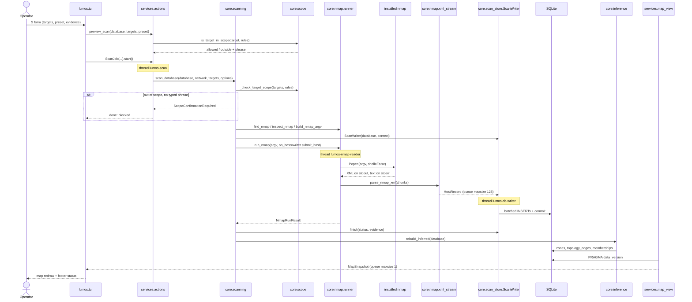

# Scan sequence

Shows one scan from the `S` form or `lumos scan` through `actions`, the scope guard, the Nmap runner and the XML parser, into the writer thread and SQLite, then the inference rebuild and the watcher back to the map.
Leaves out the form's field validation, the `--iflist` capture and import/hostname-preflight paths, and the CLI's interactive confirmation prompt.
Derived from `tui/flows.py::flow_scan`, `services/actions.py::ScanJob`, `core/scanning.py::scan_database`, `core/nmap/runner.py::run_nmap` and `core/scan_store.py::ScanWriter`.

