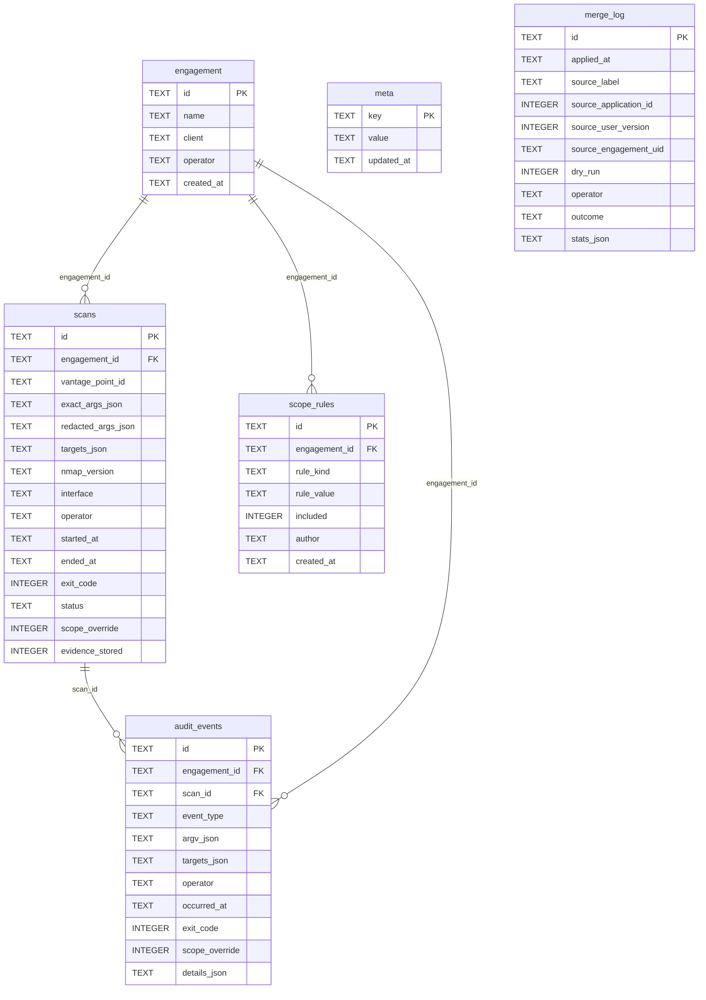

# Schema — Merge and audit

Shows engagement identity, the scan audit trail, engagement-wide scope rules and one row per merge attempt.
Leaves out tables from the other schema diagrams and every runtime query, so a relationship here is a foreign key, not a code path.
Generated by `scripts/gen_erd.py` from the schema `initialize_database` creates; do not edit by hand.

