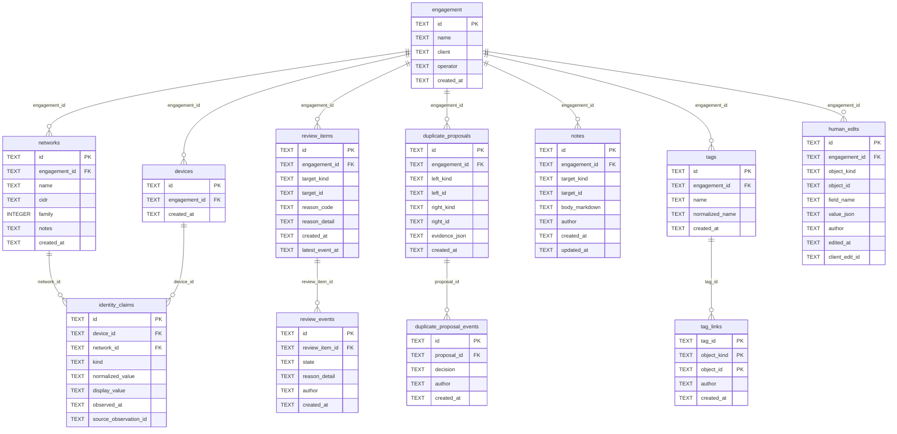

# Schema — Review and human edits

Shows the review queue, duplicate-device proposals, identity claims, notes, tags and the append-only human-edit log.
Leaves out tables from the other schema diagrams and every runtime query, so a relationship here is a foreign key, not a code path.
Generated by `scripts/gen_erd.py` from the schema `initialize_database` creates; do not edit by hand.

