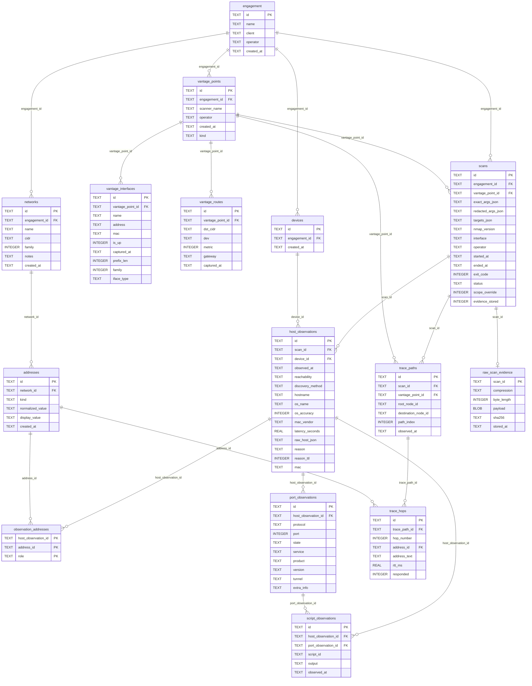

# Schema — Scan data

Shows the engagement root, the scanner's own interfaces and routes, addresses, devices, scans and the immutable observations a scan writes.
Leaves out tables from the other schema diagrams and every runtime query, so a relationship here is a foreign key, not a code path.
Generated by `scripts/gen_erd.py` from the schema `initialize_database` creates; do not edit by hand.

