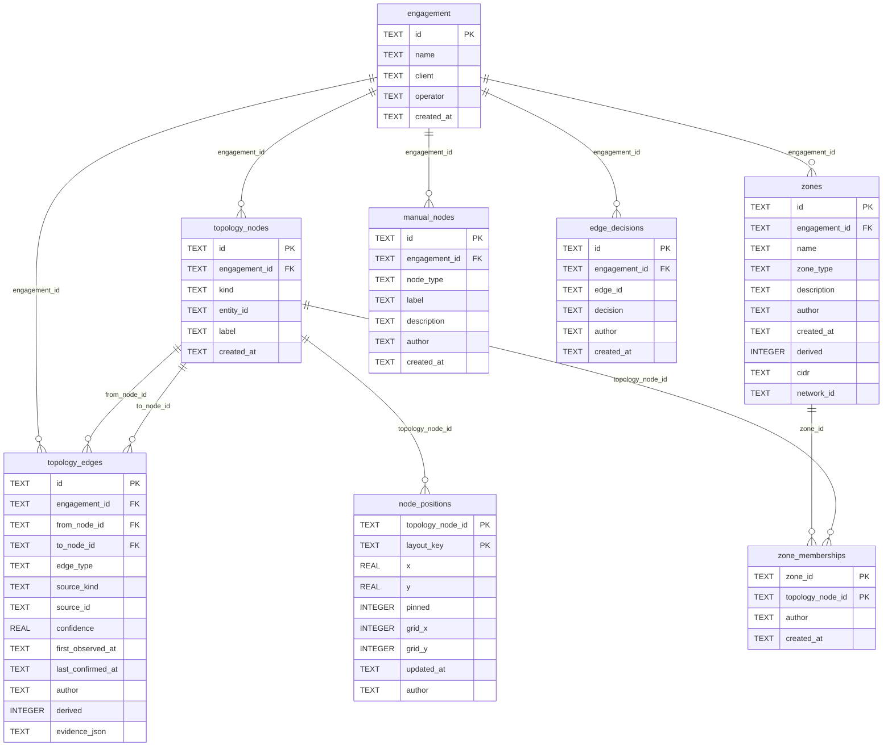

# Schema — Topology

Shows the graph itself: nodes, typed edges with provenance, derived hubs and memberships, plus the operator's promoted/rejected link decisions.
Leaves out tables from the other schema diagrams and every runtime query, so a relationship here is a foreign key, not a code path.
Generated by `scripts/gen_erd.py` from the schema `initialize_database` creates; do not edit by hand.

