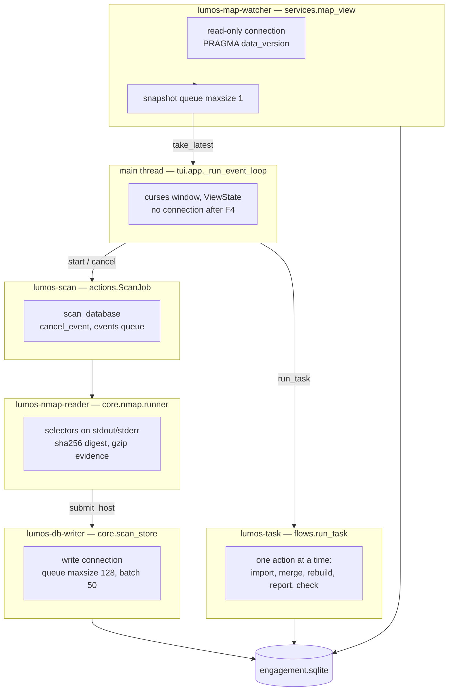

# Threads and ownership

Shows the six threads, the objects each owns and the queues between them, including which threads hold a SQLite connection.
Leaves out the CLI path (it runs `scan_database` on the main thread and has no curses loop) and the exact batch sizes and timeouts.
Derived from `tui/app.py::_run_event_loop`, `tui/flows.py::run_task`, `services/actions.py::ScanJob`, `core/nmap/runner.py::run_nmap`, `core/scan_store.py::ScanWriter` and `services/map_view.py::MapSnapshotWatcher`.

